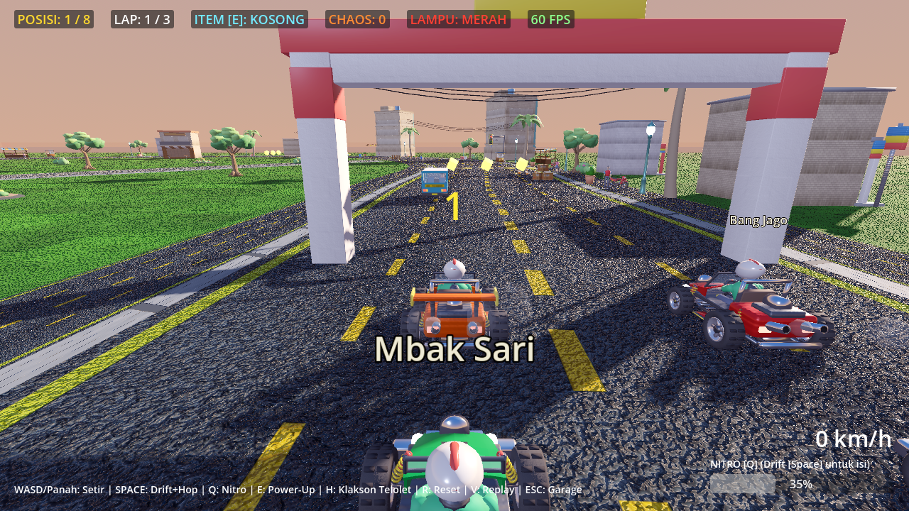

# Kart Nusantara - Chaos Racing

**Kart Nusantara - Chaos Racing** adalah game balapan gokart 3D bernuansa jalanan Indonesia (Genre: **3D Arcade Racing, Action, Comedy**) yang dibangun menggunakan **Blender 5.2** (aset `.glb` + tekstur PBR) dan **Godot 4.7.2** (renderer `GL Compatibility`, target 60 FPS pada PC kelas menengah dan siap ekspor WebGL2).



## Fitur Utama

| Fitur | Deskripsi |
| --- | --- |
| **Chaos Racing (8 Gokart)** | Balapan 8 gokart di sirkuit jalanan Indonesia melengkung (~718 m, kurva Catmull-Rom) lengkap dengan Terowongan Nusantara, taman kota terbuka, dan trotoar melandai yang bisa dilintasi bebas. |
| **AI Opponents** | 7 lawan AI dengan karakter kendaraan, gaya balap, dan tingkat agresivitas berbeda. |
| **Drift System & Nitro Boost** | Drifting menghasilkan energi turbo bertingkat dengan efek api knalpot dan asap dari pipa knalpot ganda berlubang. |
| **Garage 3D & Nama Pemain** | Pilih dan modifikasi gokart (warna bodi & kap mesin, spoiler, ukuran ban, mesin, nitro) serta ubah nama pembalap secara langsung (tersimpan otomatis di `user://player_profile.cfg`). |
| **5 Power-up Chaos** | Kulit pisang, roket kartun, bom air, tumpahan oli, dan perisai. |
| **Collision Physics & Destructible Objects** | Tabrakan dengan pantulan, guling, dan puluhan properti yang dapat dihancurkan (kardus detail, pagar kayu, gerobak bakso + penjualnya, tong, tiang, pot tanaman, traffic cone, motor & sepeda terparkir) dengan efek kardus dan kertas melayang. |
| **Dynamic Obstacles & Jalanan Hidup** | Angkot Suzuki Carry ("ANGKOT 99" pintu tengah terbuka), ayam kampung, lampu lalu lintas Merah-Kuning-Hijau yang bisa diterobos, polisi tidur (speedbump), serta pejalan kaki pria dan wanita yang berlari menghindar. |
| **Shortcut & Battle Arena** | Jalur pintas menembus taman kota, plus mode **Battle Arena** saling menghancurkan antar 8 gokart. |
| **Replay System** | Merekam momen tabrakan dan balapan untuk diputar ulang dari kamera sinematik (`V`). |
| **21 Aset Audio Realistis (ElevenLabs)** | Dual-layer suara mesin (`engine_idle` + `engine_loop` crossfade dinamis), suara angin kecepatan tinggi, kicau burung tropis, klakson kendaraan & klakson Telolet, suara tabrakan, ayam teriak, teriakan warga pria/wanita, jingle intro game, dan efek power-up. |

## Kontrol

- `W / A / S / D` atau Tombol Panah: Gas, belok kiri/kanan, rem, dan mundur
- `SPACE`: Drift & lompat kecil (Hop)
- `Q` atau `Shift`: Nitro Boost
- `E` atau `Enter`: Gunakan Power-up
- `H`: Klakson kendaraan
- `T`: Klakson Telolet
- `R`: Reset posisi kart ke lintasan
- `V`: Putar ulang Replay sinematik
- `ESC`: Kembali ke Garage 3D

Pada perangkat layar sentuh / mobile web, overlay kontrol sentuh otomatis muncul.

## Cara Menjalankan

### 1. Desktop (Windows / Linux) dengan Godot 4.7.2+

```bash
godot --path .
```

Atau jalankan langsung ke sirkuit balap:

```bash
godot --path . res://scenes/race_track.tscn
```

### 2. Verifikasi Otomatis (Headless Smoke Test)

```bash
godot_console --headless --path . --quit-after 240 res://scenes/verify_smoke.tscn
```

### 3. Ekspor Web (HTML5 / WebAssembly + WebGL2)

Pastikan template ekspor Web Godot 4.7.2 sudah terpasang, lalu jalankan:

```bash
godot_console --headless --path . --export-release "Web" "build/web/index.html"
python -m http.server 8060 --directory build/web
```

Buka `http://127.0.0.1:8060/` di browser.

## Struktur Proyek

- `assets/models/`: 30+ model 3D `.glb` hasil ekspor Blender (Bajaj Turbo Kart, Angkot 99, Ruko Indomaret/Alfamart/Kafe, Kios Buah, Gedung Kantor, Rumah Nusantara, Gerobak Bakso, Pohon, Palem, Pejalan Kaki, Motor/Sepeda, Power-up).
- `assets/textures/`: Tekstur PBR (Albedo, Normal, Roughness) termasuk aspal kerikil, batu paving trotoar, tembok ruko, dan plang lokal.
- `assets/audio/`: 21 file audio `.mp3` 44.1 kHz (ElevenLabs `eleven_text_to_sound_v2`) dengan fallback sintesis prosedural di `scripts/sfx_synth.gd`.
- `assets/blend/`: File sumber Blender (`bajaj_kart.blend`, `nusantara_assets.blend`).
- `scenes/`: `main_menu.tscn` (Garage 3D), `race_track.tscn` (Chaos Racing), `battle_arena.tscn` (Battle Arena), dan `verify_smoke.tscn`.
- `scripts/`: Skrip GDScript untuk fisika kart, AI, dunia & rintangan, audio, replay, dan UI.
- `docs/`: Screenshot publik untuk dokumentasi.
